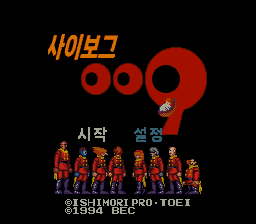
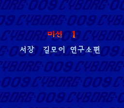
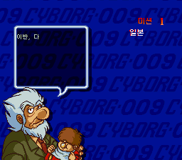
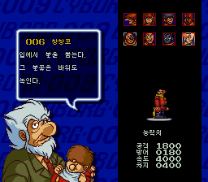
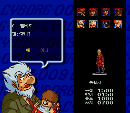
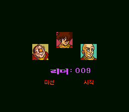
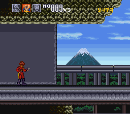

# 사이보그 009 — 슈퍼 패미컴 한글패치

일본판 **サイボーグ009(Cyborg 009)**(슈퍼 패미컴, 1994, BEC)의 비공식 한글패치 **v1.0.0 (2026-11-06)** 입니다. 외부 기계 번역 없이 직접 번역했습니다.

[정식 패치 다운로드](https://github.com/snake759494/cyborg-009-sfc-korean-patch/releases/latest) · [빌드](docs/BUILD.md) · [기술 설명](docs/TECHNICAL.md) · [검증 범위](docs/VALIDATION.md) · [권리 안내](RIGHTS.md)

## 적용 방법

1. 직접 준비한 원본 일본판 ROM(1MB, 헤더 없음)의 SHA-256이 아래 `source`와 일치하는지 확인합니다.
2. 릴리즈에서 **Cyborg_009_SFC_KR.xdelta** 하나를 받습니다.
3. xdelta UI 또는 아래 명령으로 원본에 적용합니다.
4. 결과 ROM(2MB)의 SHA-256을 확인한 뒤 새로 부팅합니다. 원본에서 만든 세이브 스테이트는 쓰지 마세요(메모리에 남은 원본 글꼴 때문에 글자가 깨집니다).

```powershell
.\xdelta.exe -D -d -s 'Cyborg 009 (Japan).sfc' 'Cyborg_009_SFC_KR.xdelta' 'Cyborg 009 (Korean).sfc'
Get-FileHash -Algorithm SHA256 'Cyborg 009 (Korean).sfc'
```

원본·패치·결과 해시를 한 번에 확인하려면 저장소의 `tools/apply_release.py`를 사용할 수 있습니다.

| 구분 | 바이트 | SHA-256 |
| --- | ---: | --- |
| source | 1,048,576 | `71e77fdbd9c865ae07e907549b02549ebe87fa8d436401c485e588c61797754a` |
| output | 2,097,152 | `5ef0c18872e1afbc2047d579f1dc648e200ad43edf4cf2158782dfeefa68f482` |
| patch | 119,821 | `38144245ba24ae7a29a904427cceb5016ebe543e4d68f7905ef90d8ecb41a825` |

xdelta는 **`-0 -S none -D`**로 빠르게 생성했습니다. 릴리즈 첨부는 xdelta 하나이며 ROM·폰트·외부 실행파일·저장 파일은 포함하지 않습니다.

## 한글화 내용

- **대사 66묶음 전체**: 미션 브리핑, 사이보그 프로필, 팀 편성 대사와 확인 선택지, 미션 중 통신 대사. 한글 397자를 대사용 동적 글꼴(갈무리7 8×8)로 표시합니다.
- **오프닝 프롤로그 자막**(나눔스퀘어 네오).
- **타이틀 화면**: 로고 아래 「사이보그」, 메뉴 「시작」·「설정」.
- **설정 화면**: 사운드 테스트(배경음/효과음), 음성 출력(스테레오/모노), 조작 타입(특수1·특수2·광선·점프), 밝기(어둠/밝음), 난이도(쉬움/보통/어려움), 컨티뉴 횟수, 나가기.
- **미션 타이틀 카드**: 「미션」·「최종 미션」 큰 글자와 부제 5종(서장 길모어 연구소편 / 잠입 비밀기지편 / 빙해의 격투 북극해편 / 하늘의 위협 부유요새편 / 결전 본거지 병기공장편).
- **브리핑 화면**: 미션 표시와 지역명(일본·영국·북극해·그리스·독일), 「시작」.
- **팀 편성**: 능력치(공격·방어·속도·차지), 「예/아니」, 출격 화면 「리더: 009」.
- **게임 중**: 일시정지 표시 「일시정지」.
- **결과·랭킹·컨티뉴**: 「미션 클리어」·「격파」·「시간」·「점수」, 랭킹 제목과 표 머리(순위·점수·이름·미션), 「컨티뉴 ?」와 「예/아니오」.
- 글꼴: 큰 제목·메뉴는 **나눔스퀘어 네오**, 미션 카드 부제는 **서울한강체 EB**, 대사와 아주 작은 글자에만 **갈무리7·9**.

 
 
 


## 영어·원문으로 남은 부분

- 게임 화면 상단 표시 `NO`, `SP`, `HP`, `EX`(약어).
- 랭킹 이름 입력의 A~Z 알파벳(입력 문자 자체).
- 타이틀 저작권 표기.

## 검증 범위

헤드리스 snes9x(libretro)로 최종 해시의 ROM을 실행해 타이틀, 설정 화면, 프롤로그·브리핑 대사, 미션 카드, 팀 편성, 출격 화면, 1스테이지 플레이와 일시정지, 결과·랭킹·컨티뉴 화면을 확인했습니다. 공개 도구로 재빌드한 결과가 릴리즈 ROM과 바이트 단위로 같음을 확인했습니다. 검증용 에뮬레이터는 종료했습니다.

**전편 실제 플레이(특히 후반 미션과 엔딩·스태프 롤의 실제 화면), 실기 검증은 미실시입니다.** 자세한 내용은 [검증 문서](docs/VALIDATION.md)를 확인하세요.

## 공개 자료

`translation/script_ko.txt`에 직접 번역한 한국어 대사를, `tools/`에 빌드 도구(파이썬, 65816 훅 코드 포함)를 공개합니다. 일본어 원문은 포함하지 않으며 빌드 시 사용자 ROM에서 읽습니다. 재빌드에는 사용자가 준비한 원본 ROM과 해시가 맞는 공식 글꼴이 필요합니다. 이 저장소는 원작이나 글꼴의 권리를 부여하지 않습니다.

문제 제보에는 원본·결과 ROM 해시, 발생 위치, 재현 순서와 화면 캡처를 첨부해 주세요. ROM 파일과 저장 파일은 공개 이슈에 올리지 마세요.
